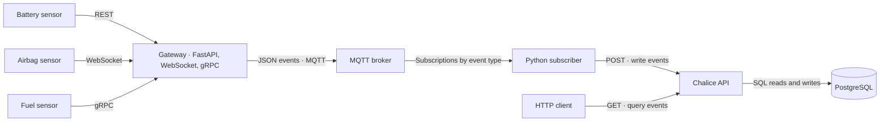

# Vehicle IoT Platform

A local lab for streaming vehicle telemetry and querying sensor history. It simulates battery metrics, airbag events, and fuel levels. The demo runs Mosquitto, PostgreSQL, and the Chalice API with Docker Compose.

## Architecture



| Telemetry | Gateway input | MQTT topic |
| --- | --- | --- |
| Battery | `POST /api/vehicle/battery` | `data/{vehicle_id}/battery/{sensor_id}/metrics` |
| Airbag | JSON message over WebSocket | `data/{vehicle_id}/airbag/{sensor_id}/events` |
| Fuel | `FuelSensorService.SendFuelData` | `data/{vehicle_id}/fuel/{sensor_id}/level` |

The subscriber maps incoming events to the format the API expects. PostgreSQL stores vehicles and sensors, separate event tables for each sensor type, and a shared actuator catalog. The [demo schema](postgres/init.sql) seeds vehicle `car001` with sensors `battery001`, `airbag001`, and `fuel001`.

## Quick start

Install Docker with Compose v2 and BuildKit. From the repository root, run:

```bash
docker compose up -d --build
docker compose ps
```

The gateway listens on `localhost:5100` for REST, `localhost:8865` for WebSocket, and `localhost:51051` for gRPC. The query API listens on `localhost:8100`. Mosquitto and PostgreSQL are accessible on the internal Compose network.

Once the services are running, allow one sensor cycle (up to 30 seconds). Each query should return a nonempty `events` array.

```bash
base=http://localhost:8100/data/car001/sensors
curl -fsS "$base/battery/battery001/events"
curl -fsS "$base/airbag/airbag001/events"
curl -fsS "$base/fuel/fuel001/events"
```

Run `docker compose logs gateway subscriber api` to follow event processing. Run `docker compose down` to stop the containers and retain the database volume.

If your HTTPS proxy requires a custom CA, run `docker compose -f compose.yaml -f compose.cloud.yaml up -d --build`. Set `BUILD_CA_FILE` if your trust bundle is at a path other than `/etc/ssl/certs/ca-certificates.crt`.

## Chalice API

| Method | Route | Operation |
| --- | --- | --- |
| GET | `/data` | Check API availability |
| GET / POST | `/data/{vehicle_id}/sensors` | List or register sensors |
| POST | `/data/{vehicle_id}/sensors/{sensor_type}/{sensor_id}` | Record a battery, airbag, or fuel event |
| GET | `/data/{vehicle_id}/sensors/{sensor_type}/{sensor_id}/events` | Retrieve up to 50 recent events for the sensor |
| GET / POST | `/data/{vehicle_id}/actuators` | List or register entries in the shared actuator catalog |

See [sensors.proto](sensor-grpc/sensors.proto) for the gRPC contract and the [AWS IoT Core guide](docs/aws-iot.md) for broker, authentication, and network settings.

## Repository layout

| Path | Contents |
| --- | --- |
| [gateway/](gateway/) | REST, WebSocket, and gRPC inputs and MQTT publishing |
| [subscriber/](subscriber/) | Routing MQTT events to Chalice |
| [API-Chalice/](API-Chalice/) | HTTP API and PostgreSQL access |
| [sensor-rest/](sensor-rest/), [sensor-webSocket/](sensor-webSocket/), [sensor-grpc/](sensor-grpc/) | Battery, airbag, and fuel simulators |
| [postgres/](postgres/) | SQL schema and demo data |
